# Wordle

Wordle clone as a WPF desktop app in C# (PXL Graduaat Programmeren, WPL1 2024-25).

**Tech:** C#, .NET, WPF/XAML.

---

[](https://classroom.github.com/a/J-nfZUjk)
# 1. Overzicht opdracht

## 1.1 Doel van het project
Tijdens de projectweken van WPL1 wordt er naast een C#-project ook een web toepassing uitgewerkt. Doel is om de kennis uit de lessen om te zetten in de praktijk gedurende een langlopende opdracht.  

### C# toepassing (WORDLE)  

Tijdens dit project zullen we het spel WORDLE in C# bouwen in 3 fasen. Hiermee zullen we de competenties rond C# en WPF verder uitdiepen. Je zal uitgedaagd worden om je kennis te verbreden door zelf aan de slag te gaan en informatie op te zoeken over hoe je de verschillende programmeervereisten zou implementeren.


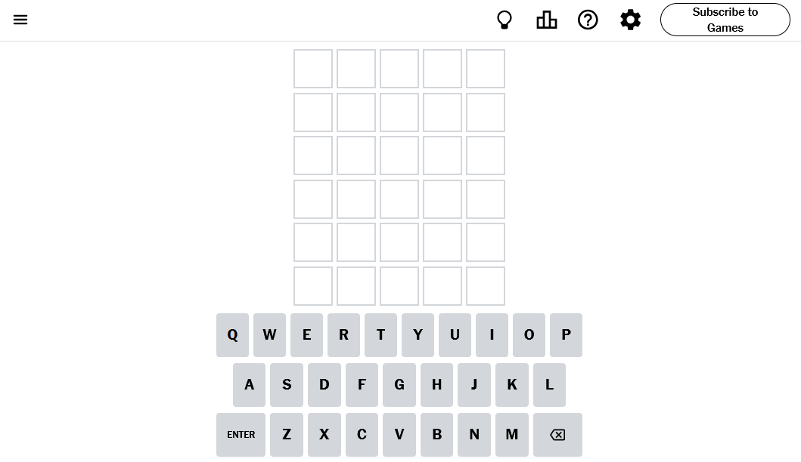

<p style="text-align:center;font-style:italic">screenshot van het spel op de website van de New York Times</p>

## 1.2 Planning & Fasen

De volledige toepassing zal worden geïmplementeerd in verschillende fasen. In elke fase worden telkens nieuwe functionaliteiten toegevoegd aan het project. Op deze manier worden ook de complexiteit en nodige skills stapsgewijs opgebouwd.

| fase      | Uitleg      | Deadline & PE |
|-----------|-------------|---------------|
| **1**     | **Week 7**  | **Week 9**    |
| **2**     | **Week 9**  | **Week 11**   |
| **3**     | **Week 11** | **Week 13**   |

Elke fase wordt dus gebouwd in één week WPL1 (afwisselend met het Web project). Dit houdt in dat tijdens de WPL1 sessie aan het project gewerkt wordt onder begeleiding van de coaches. Er wordt echter verwacht van de studenten dat, als ze niet klaar zijn, dit verder afgewerkt wordt buiten de begeleide sessie. 

De deadline is **de avond voor de dag van de WPL1 les**. Met andere woorden voor **<span style="color:red">Week 9</span>** is de <span style="color:red">**deadline woensdag 20/11/2024 om 23:59.**</span> Je zal tijdens de les een uitbreiding maken op je project die beoordeeld wordt.

## 1.3 Opdracht indienen & Evaluatie

Je dient je project in op blackboard door de URL naar je githubclassroom repository te posten in de inzending en je code te pushen naar deze repository. Je bent zelf verantwoordelijk voor het pushen van je code op de githubclassroom repository.

Let op!
 - Je maakt <span style="color:red">**niet**</span> zelf een nieuwe repository aan. Gebruik de repository van Github.
 - Push en commit **regelmatig**. Code die lokaal staat kan niet beoordeeld worden.
 - **De projecten worden individueel gemaakt.** In geval van plagiaat, samenwerking of fraude, wordt er een <span style="color:red">**onvoldoende toegekend voor alle partijen.**</span>

# 2. Basis versie WORDLE (sprint 1)

Het project is gebaseerd op het spel Wordle, een onlinespel gepubliceerd door de New York Times. In het spel heeft de speler het doel om in zo weinig mogelijk pogingen het juiste woord te raden.

Probeer zelf het <a href="https://www.nytimes.com/games/wordle/index.html">spel</a> eens uit.

## 2.1 Spelverloop

Aan het begin van het spel wordt er een willekeurig vijfletterwoord gekozen uit een vooraf bepaalde lijst van woorden. Het doel van de speler is om dit woord binnen een maximum van 6 pogingen te raden. Na elke poging krijgt de speler feedback over de juistheid van de letters:

## Basic HTML and CSS

- <span style="color:gray">**Grijs**</span>: de letter komt niet voor in het woord.
- <span style="color:khaki">**Geel**</span>: de letter komt voor in het woord, maar staat op een andere positie.
- <span style="color:green">**Groen**</span>: de letter komt minstens één maal voor in het woord en staat op de juiste positie.

Met andere woorden het is mogelijk dat letters meerdere keren voorkomen in een woord, maar als speler krijg je enkel een kleurcode voor de positie waar je de letter ingeeft.

**In de eerste sprint** wordt er nog niet verwacht dat je de volledige applicatie implementeert. In plaats daarvan focus je op het verwerken van **input** en **output**. Je zal er voor zorgen dat je applicatie letters kan verwerken die de speler ingeeft. Vervolgens zal je de ingegeven letters controleren en er feedback op geven. Tot slot voorzie je een reset-knop die de invulvelden weer leeg kan maken.

Je moet nog niet meerdere regels van invulvelden maken. Noch moet het geheime woord willekeurig gekozen worden. Deze uitbreidingen en meer volgen in de volgende twee sprints.


## 2.2 Technische analyse

### 2.2.1 Technische vereisten

- **C#** om de logica van de applicatie te creëren.
- **XAML** om de gebruikersinterface te bouwen.
- **Visual Studio** als programmeeromgeving.
- **Git** voor het versiebeheer van het programma.

## 2.3 Functionele analyse

### 2.3.1 Ontwerp – User interface

Een eenvoudige opzet voor de gebruikersinterface bevat een startscherm (zie Figuur 1) en een scherm om letters in te voeren en feedback te tonen na elke poging (zie Figuur 2). Het wordt aanbevolen om een eigen ontwerp te maken voor je versie van Wordle.

**Figuur 1**: Startscherm – Begin van het spel.

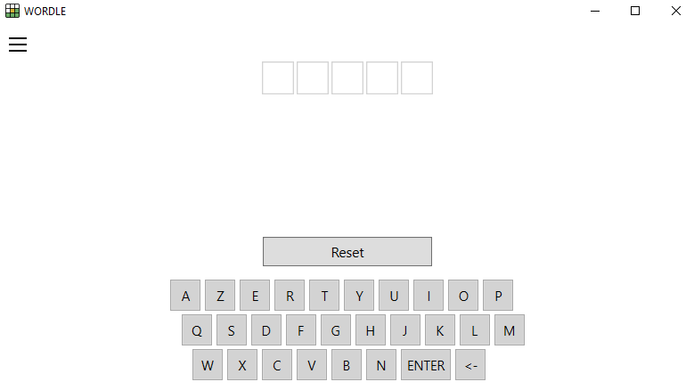

**Figuur 2**: Feedbackscherm – De ingevoerde letters worden beoordeeld en de feedback wordt getoond door middel van gekleurde vakken.

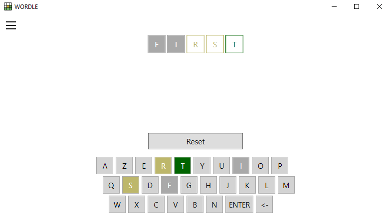

**Figuur 3**: Reset – De feedback wordt bewaard op het toetsenbord, maar de invulvelden worden terug leeggemaakt.

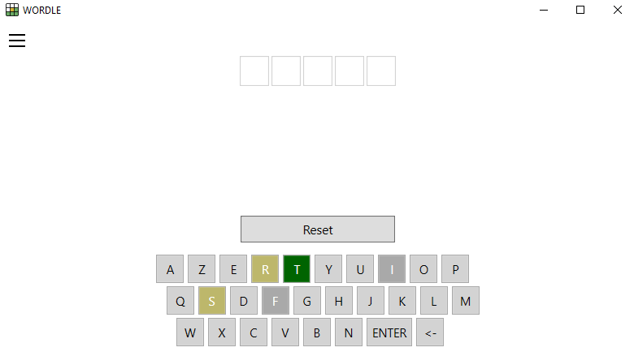

**Figuur 4**: Winnen - De speler heeft het correcte vijfletter woord ingegeven en wordt gefeliciteerd.

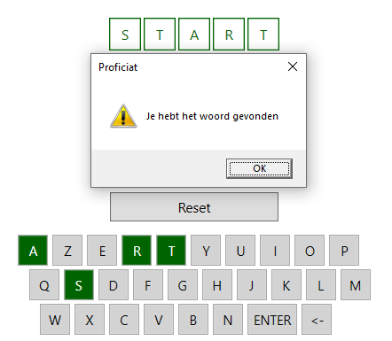


**Belangrijk**: Deze afbeeldingen zijn louter voorbeelden. Het is de bedoeling om je eigen lay-out voor het spel te bepalen. 

### 2.3.2 Functionele vereisten

| ID         | Onderwerp           | Beschrijving |
|------------|---------------------|--------------|
| **WORDL-01** | **Opstarten**       | De applicatie start in een begintoestand waarbij er vijf lege invoervelden worden getoond en een knop om het woord te valideren.  _(Zie figuur 1)_  |
| **WORDL-02** | **Woordkeuze**      | Bij het opstarten van het programma wordt er nog geen willekeurig woord gekozen. In plaats daarvan mag je het geheime woord voor de eerste sprint hardcoded in je applicatie bewaren. |
| **WORDL-03** | **Invoervelden met rand**    | Vijf invoervelden worden weergegeven waarin de speler letters kan typen. Elk veld moet een rand hebben en staat voor een letter in het woord. Als speler kan ik enkel alfabetische letters typen in de invulvelden. |
| **WORDL-04** | **Rechtstreeks in velden typen** | Als speler kan ik zonder mijn cursor in één van de velden te plaatsen onmiddellijk typen in de invulvelden. _(Tip: Gebruik hiervoor Window_KeyDown om dit te realiseren.)_|
| **WORDL-05** | **Woord indienen**   | Als speler kan ik een woord indienen voor evaluatie door op de ENTER/RETURN toets te drukken op het toetsenbord. Enkel een woord van exact vijf letters kan ingediend worden. |
| **WORDL-06** | **Woord controleren** | Wanneer de speler een poging indient voor evaluatie, wordt het ingevoerde woord gecontroleerd. Na controle verandert de kleur van elk invulveld om feedback te geven: <span style="color:gray">**grijs**</span> voor een foutieve letter, <span style="color:khaki">**geel**</span> voor een letter op de verkeerde plek, en <span style="color:green">**groen**</span> voor een juiste letter op de juiste plek. Pas minstens de kleur van de rand van de invulvelden aan. _(Zie figuur 2)_ |
| **WORDL-07** | **Toetsenbord in het venster**   | Als speler kan ik gebruik maken van een virtueel toetsenbord dat in het venster getoond wordt om mijn letters in te geven. Verder is er een Backspace- en Enter-toets aanwezig op het toetsenbord. Hiermee kunnen letters verwijderd worden _(Backspace zie WORDL-08)_ en pogingen worden ingediend _(Enter/Return zie WORDL-05)_. |
| **WORDL-08** | **Letters verwijderen**   | Als speler kan ik letters die ik heb ingevuld verwijderen door op de Backspace-toets te drukken. Zowel op het virtueel toetsenbord op het scherm _(Zie WORDL-07)_, als op het fysiek toetsenbord. |
| **WORDL-09** | **Feedback op toetsenbord**   | De kleuren-feedback van WORDL-06 kan de speler ook terugvinden op het toetsenbord. De kleuren van de knoppen veranderen, zodat de speler geholpen wordt met het kiezen van zijn of haar letters. _(Zie figuur 2)_  |
| **WORDL-10** | **Reset knop**   | Als speler kan ik op de reset-knop klikken om alle ingegeven letters en feedback te verwijderen, zodat ik nog een poging kan maken. De kleurcodes op het toetsenbord blijven echter wel staan.  _(Zie figuur 3)_  |
| **WORDL-11** | **Winnen**   | Als speler kan ik het juiste woord indienen om een berichtvenster te zien dat me feliciteert met het vinden van het correcte woord.   _(Zie figuur 4)_ |

## 2.4 Aanpak en tips

### 2.4.1 Stappenplan

- Analyseer wat er geprogrammeerd moet worden en werk een plan uit voor de implementatie. (Je zou de stappen op voorhand al kunnen uitschrijven in nog-in-te-vullen methodes.)
- Probeer te ontdekken welk onderdeel het meest uitdagend is (bijv. het genereren van feedback met de juiste kleuren) en onderzoek hoe je dit kunt oplossen.
- Test het spel om te zien of het correct werkt onder verschillende omstandigheden.
- Zorg ervoor dat je code goed gestructureerd is met duidelijke variabele- en methodnamen.

### 2.4.2 Programmeertips
- Probeer eerst de applicatie te bouwen zonder een toetsenbord in het venster.
- Maak een method aan die het ingevoerde woord controleert en de juiste kleuren toewijst aan elke letter.
- Gebruik private class-variabelen om het woord en pogingen te bewaren.
- Gebruik een Border of BorderBrush voor de rand van elk invoerveld om feedback te tonen.
- Gebruik Window_KeyDown om input van het toetsenbord op te vangen.

# 3. Sprint 1 PE

## 3.1 Doelstellingen

In deze korte uitbreiding implementeren we debug-ondersteuning van het project. We voegen onder andere een debug-modus toe, een timer om de oplostijd bij te houden, een guess-counter, en een knop om een nieuw spel te starten. Deze uitbreidingen moeten helpen bij het testen van de applicatie.

## 3.2 Functionele analyse

### 3.2.1 Ontwerp – User interface

**Figuur 5**: Debug Menu - Wanneer de speler op F2 drukt, dan wordt een debug overzicht getoond *(zie PE-02 en PE-03)*.

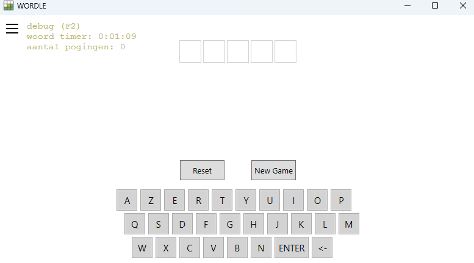

**Belangrijk**: Deze afbeelding is louter een voorbeeld. Het is de bedoeling om je eigen lay-out voor het spel te bepalen. 

### 3.2.2 Functionele vereisten

| ID         | Onderwerp           | Beschrijving |
|------------|---------------------|--------------|
| **PE1-01** | **Debug Hotkey** | Als gebruiker kan ik wanneer de applicatie actief is de debug-modus activeren door op de F2-toets te drukken. **Let er op** dat het menu geactiveerd kan worden ongeacht welk element geselecteerd is in het venster. In debug-modus wordt de correcte oplossing weergegeven in een speciale debug-tekstveld dat enkel zichtbaar is in deze modus. </br></br> **Gebruik een methode ToggleDebugVisibility()** die het debug menu toont, als het niet zichtbaar is en andersom. |
| **PE1-02** | **Timer voor oplostijd**  | Als gebruiker kan ik in de debug-modus zien hoeveel tijd er verstreken is sinds de start van mijn zoektocht naar het woord. De verstreken tijd wordt samen met de oplossing in het debug-tekstveld getoond en heeft het volgende **formaat: hh:mm:ss**. </br></br> **Gebruik de naam gameTimer** voor je timer object. |
| **PE1-03** | **Poging teller**  | Als gebruiker kan ik in de debug-modus zien hoeveel pogingen ik reeds heb gewaagd. Deze informatie telt het aantal guesses en staat in het debug-tekstveld. </br></br> **Gebruik de naam guessCounter** voor de variabele die het aantal pogingen opslaat.|
| **PE1-04** | **Nieuw spel** | Als gebruiker kan ik op de "Nieuw spel"-knop klikken om een nieuw spel te starten. Wanneer een nieuw spel gestart wordt, dan moet je **nog geen nieuw woord** instellen. Het nieuwe spel **reset** wel de **timer van de oplostijd** en reset ook de **teller** die het **aantal pogingen** bewaard. Verder wordt alle visuele feedback (groene, gele en grijze kleuren) van het woord op het scherm verwijderd, zowel in de invulvelden als op het virtuele toetsenbord. </br></br> **Gebruik de naam newGameButton** voor de knop die je aanmaakt. </br></br> Je hergebruikt met andere woorden veel van het gedrag van de reset-knop. Probeer duplicate code te vermijden. |
| **PE1-05** | **XML documentatie** | Voorzie zinvolle **XML summary documentatie** voor de volgende onderdelen in je project: **ToggleDebugVisibility()**, **gameTimer**, **guessCounter** en **newGameButton_Click()**. |

### Veel succes!

# 4. Uitgebreide versie WORDLE (sprint 2)

## 4.1 Doelstellingen

De eerste versie van het spel is klaar. In deze opdracht gaan we ons focussen op zogenaamde **change requests**, zowel functioneel als technisch en hoe daar mee om te gaan.  

We gaan het spel uitbreiden, maar ook aanpassen. Het doel is om het vorige spel (sprint 1) in zijn huidige vorm te behouden en niet te overschrijven, maar aan te passen. Je moet dus niet opnieuw beginnen. Hierdoor kunnen we bijvoorbeeld het spel (fictief) op de markt brengen in zowel een basis versie (aan lagere prijs) als ook een uitgebreide versie (hogere prijs). Anderzijds simuleert dit de feedback van de klant die enkele opmerkingen heeft na deze eerste oplevering.

We maken deze iteratie de volgende aanpassingen in het concept van het spel: 
- Het geheime woord zal willekeurig gekozen worden.
- De vorige ingediende pogingen blijven zichtbaar op het scherm samen met hun kleurenfeedback. De speler heeft exact 6 pogingen om het correcte woord te raden.
- We beperken het aantal pogingen voor de speler tot 6.
- Er zal een "Volgend woord"-knop zijn die het scherm terug op de startsituatie brengt met een nieuw willekeurig geheim woord. _(Zie figuur 5)_
- De applicatie gaat gebruik maken van data structuren, nl. arrays, om een verzameling van vijfletterwoorden op te slaan.

## 4.2 Technische analyse

### 4.2.1 Technische vereisten

- **C#** om de logica van de applicatie te creëren.
- **XAML** om de gebruikersinterface te bouwen.
- **Visual Studio** als programmeeromgeving.
- **Git** voor het versiebeheer van het programma.

## 4.3 Functionele analyse

### 4.3.1 Ontwerp – User interface

**Figuur 6**: 6 pogingen – Een speler kan exact zes pogingen maken en de vorige pogingen blijven zichtbaar.

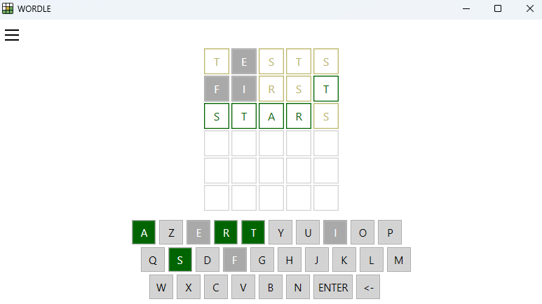

**Figuur 7**: Hover Effect - De letter R is donkergeel gekleurd door het hover effect *(zie WORDL-20)*.

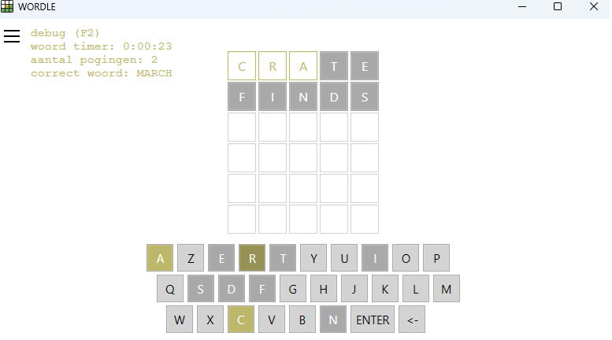


**Belangrijk**: Deze afbeeldingen zijn louter voorbeelden. Het is de bedoeling om je eigen lay-out voor het spel te bepalen. 

### 4.3.2 Functionele vereisten

| ID         | Onderwerp           | Beschrijving |
|------------|---------------------|--------------|
| **WORDL-12** | **Woordenlijst**  | Stel zelf een lijst op van minstens 20 vijfletterwoorden die als mogelijke antwoorden kunnen dienen voor jouw WORDL spel. Deze woordenlijst dient als de database waaruit de applicatie een oplossing kiest bij het starten van een nieuw spel. |
| **WORDL-13** | **Random Woord**  | Wanneer de applicatie wordt gestart, dan wordt er een willekeurig vijfletterwoord gekozen als oplossing voor het spel. Gebruik hiervoor de woordenlijst van WORDL-12. |
| **WORDL-14** | **Vorige Pogingen Zichtbaar**  | Als speler zie ik alle eerdere pogingen samen met de bijbehorende kleurenfeedback weergegeven op het scherm. Dit geeft de speler een visuele geschiedenis van eerdere pogingen en de kleurcodes (grijs, geel, groen) die aangeven hoe dicht de poging bij het juiste woord komt. _(Zie figuur 5)_ |
| **WORDL-15** | **Pogingen Beperken**  | Het aantal pogingen om het juiste woord te raden is beperkt tot zes. Na zes onjuiste pogingen kan de speler geen nieuwe poging meer invoeren. Je visualiseert deze zes pogingen door op voorhand zes rijen van invulvelden te presenteren. _(Zie figuur 5)_ |
| **WORDL-16** | **Verliezen**  | Als ik als speler niet het juiste woord binnen zes pogingen kon raden, dan wordt het spel beëindigd met een bericht dat aangeeft dat ik het spel verloren heb. Het juiste woord wordt hierbij onthuld via een berichtvenster of tekstveld, zodat de speler ziet wat de oplossing was. |
| **WORDL-17** | **Volgend woord-knop**  | Als speler kan ik op een "Volgend Woord"-knop klikken om een nieuw spel te starten. Hierbij wordt een nieuw willekeurige vijfletterwoord geselecteerd (uit de woordenlijst). Verder worden alle velden gereset van hun visuele feedback. Hierdoor kan het spel opnieuw gespeeld worden zonder de applicatie opnieuw te starten. _(Zie figuur 6)_  |
| **WORDL-18** | **Schaalbaarheid layout**  | Zorg ervoor dat de layout van de gebruikersinterface flexibel is en zich automatisch aanpast aan verschillende schermgroottes. De belangrijkste elementen moeten altijd goed zichtbaar en gemakkelijk te gebruiken zijn, ongeacht de grootte van het venster waarop de applicatie draait. |
| **WORDL-19** | **Schaalbaarheid tekst**  | De tekst-elementen passen zich automatisch aan de schermgrootte aan. Dit zorgt ervoor dat de tekst leesbaar blijft op zowel kleine als grote schermen. |
| **WORDL-20** | **Hover effecten**  | Als speler krijg ik visuele feedback dat iets klikbaar is door middel van een hovereffect dat de kleur aanpast van het klikbare element. </br></br> **Let op:** dit hover effect houdt rekening met de kleurcodes die op het toetsenbord staan. Een geel gecodeerde toets krijgt bijvoorbeeld een donkergeel hover effect. _(Zie figuur 7)_  |

## 4.4 Aanpak en tips

### 4.4.1 Stappenplan
- Analyseer grondig wat er geprogrammeerd moet worden en hoe je dat gaat doen.
- Analyseer grondig welke impact de nieuwe vereisten hebben op de code die je al geschreven had. En hoe je deze moet aanpassen. 
- Reflecteer of je je code van in het begin al meer generiek had kunnen schrijven om dit soort wijzigingen op te vangen.
- Reflecteer of je te veel gebruik hebt gemaakt van de toegelaten vrijheden als programmeur. En of je huidige versie misschien conflicten heeft met de vereisten van C.1.
- Afhankelijk van de aanwezigheid van conflicten met de oude of nieuwe vereisten, zal je je aanpak moeten aanpassen om zo veel mogelijk code te kunnen hergebruiken, maar toch in lijn te zijn met de vereisten.
- Test het spel om te zien of het in alle omstandigheden werkt.
- Zorg ervoor dat je code mooi gestructureerd is (vb. gebruik zinvolle namen voor variabelen/methoden/…).
- Zorg ervoor dat de GUI gebruiksvriendelijk en overzichtelijk oogt.

### 4.4.2 Programmeertips
- Gebruik een array of een List om een vijfletterwoord-lijst op te slaan.
- Maak gebruik van de MessageBox om berichtvensters te tonen.
- Gebruik methodes voor acties die je meerdere keren in de flow van de applicatie wil uitvoeren, zoals: de user interface resetten en een willekeurig woord selecteren.
- Om schaalbaarheid van je applicatie te verbeteren kan je een Viewbox gebruiken en werken met (een combinatie van) panels.

# 5. Sprint 2 PE

## 5.1 Doelstellingen

Net zoals in de vorige PE is de focus van de Sprint 2 PE op het uitbreiden van het debug-menu. Verder heb je er voor gezorgd dat je applicatie een schaalbare layout gebruikt. Zorg er voor dat enige aanpassingen tijdens de PE nog steeds resulteren in een schaalbaar resultaat.

Tijdens de PE zal je er voor zorgen dat de gebruiker van nog meer gebruiksvriendelijkheid geniet. Er zullen tooltips zijn voor het toetsenbord die de gebruiker nogmaals wijzen op de betekenis van de kleuren. Verder voeg je een statusbalk toe met de hoeveelheid correct gevonden woorden.

## 5.2 Functionele analyse

### 5.2.1 Ontwerp – User interface

**Figuur 8**: Debug Menu - De speler kan nu in het debug-menu altijd de groene, gele en grijze letters terugvinden in een alfabetische volgorde *(zie PE-06 tot PE-08)*.

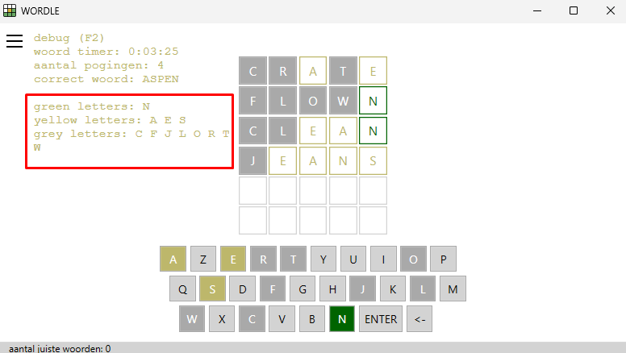

**Figuur 9**: Geel naar groen - De gele letter "I" in het woord NOISE wordt groen wanneer het woord VISIT wordt ingegeven. De letter wordt verwijderd uit de `yellowLetters` array en geplaatst in de `greenLetters` array *(zie PE-09)*.

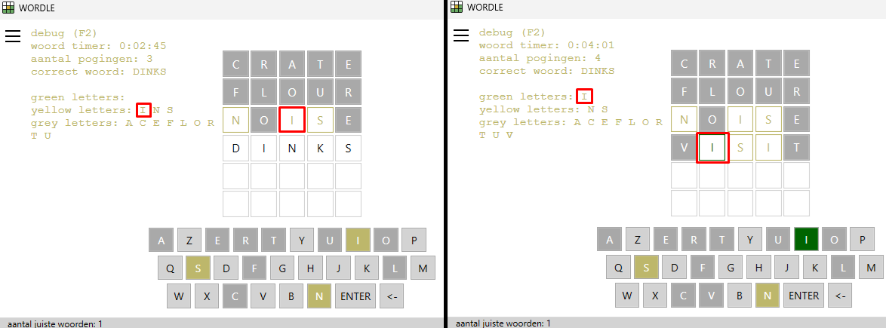

**Figuur 10**: Unieke letters - De letter "O" verschijnt tweemaal in het woord SPOON, maar de letter wordt maximaal één keer opgenomen in de corresponderende `yellowLetters` array *(zie PE-10)*.

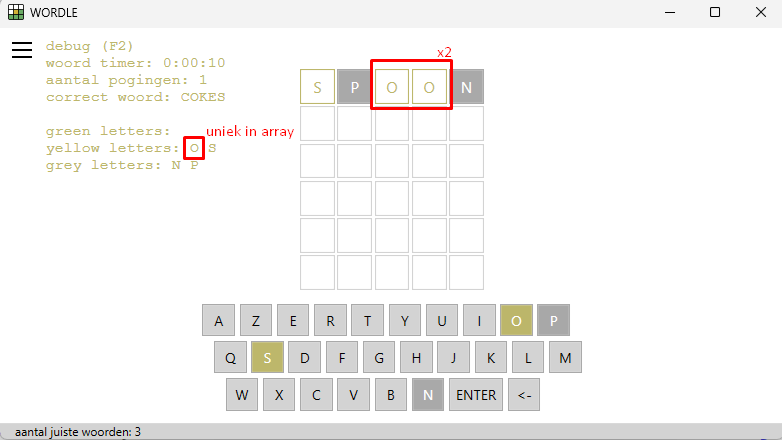

**Figuur 11**: Gesorteerde letters - De letters verschijnen allemaal in alfabetische volgorde in het debug-menu. Bovendien blijven ze altijd allemaal zichtbaar (ookal zijn er bijzonder veel grijze letters). *(Zie PE-11)*.

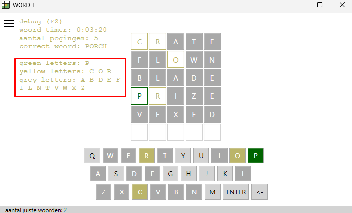

**Figuur 12**: Tooltip groene letter - correct letter, correct place *(zie PE-12)*.

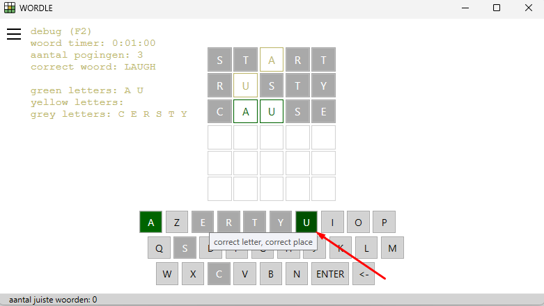

**Figuur 13**: Tooltip gele letter - correct letter, incorrect place *(zie PE-12)*.

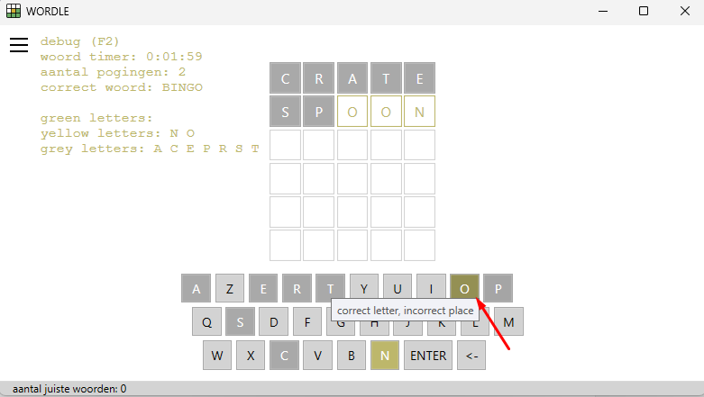

**Figuur 14**: Tooltip grijze letter - incorrect letter *(zie PE-12)*.

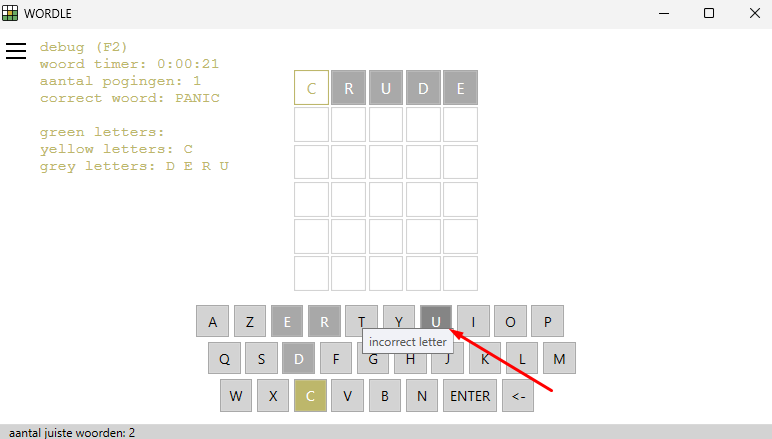


**Belangrijk**: Deze afbeeldingen zijn louter een voorbeeld. Het is de bedoeling om je eigen lay-out voor het spel te bepalen. 

### 5.2.2 Functionele vereisten

| ID         | Onderwerp                      | Beschrijving                                                                                                                         |
|------------|--------------------------------|-------------------------------------------------------------------------------------------------------------------------------------|
| **PE1-06** | **Debug bevat groene letters** | Gebruik een methode `AddLetterToGreens(string letter)` om een letter toe te voegen aan een array genaamd `greenLetters`. Deze array heeft een maximale grootte gelijk aan de hoeveelheid letters in het te raden woord. </br></br> Deze groene letters zijn opgesomd in het debug-menu *(Zie figuur 8)*. |
| **PE1-07** | **Debug bevat gele letters**   | Gebruik een methode `AddLetterToYellows(string letter)` om een letter toe te voegen aan een array genaamd `yellowLetters`. Deze array heeft een maximale grootte gelijk aan het te raden woord. Een letter kan niet worden toegevoegd aan de `yellowLetters` array als deze al voorkomt in de `yellowLetters` array. </br></br> Deze gele letters zijn opgesomd in het debug-menu *(Zie figuur 8)*.  |
| **PE1-08** | **Debug bevat grijze letters** | Gebruik een methode `AddLetterToGreys(string letter)` om een letter toe te voegen aan een array genaamd `greyLetters`. Deze array kan maximaal 26 elementen bevatten, waarbij elk element een unieke letter van het alfabet is. </br></br>Deze grijze letters zijn opgesomd in het debug-menu *(Zie figuur 8)* |
| **PE1-09** | **Geel naar groen**            | Wanneer een letter van geel naar groen verandert, dan wordt deze automatisch verwijderd uit de `yellowLetters` array. Gebruik hiervoor een methode `RemoveLetterFromYellows(string letter)` om de letter te verwijderen. *(Zie figuur 9)* |
| **PE1-10** | **Unieke letters in elke array** | Zorg ervoor dat in de arrays `greenLetters`, `yellowLetters` en `greyLetters` elke letter maximaal één keer voorkomt. Voorkom duplicaten bij het toevoegen van letters aan een van de arrays. Deze mogen ook niet dubbel verschijnen in het debug-menu. *(Zie figuur 10)* |
| **PE1-11** | **Letters gesorteerd**         | Als gebruiker moeten de letters in het debug-menu altijd in alfabetische volgorde worden weergegeven. Bovendien hou je er rekening mee dat alle letters altijd zichtbaar zijn wanneer het debug-menu actief is. De letters mogen niet achter een ander besturingselement verdwijnen of uit het venster vallen. *(Zie figuur 11)* </br></br> Gebruik hiervoor een methode genaamd `DebugLetterStatus()` die een `string` teruggeeft met het deel van de output voor het debug-menu.|
| **PE1-12** | **Tooltip**                    | Voeg tooltips toe aan de toetsen van het virtueel toetsenbord. De tooltip geeft extra uitleg over de kleurcode van de letter. *(Zie figuur 12 tot 14)* |
| **PE1-13** | **Aantal correcte woorden in statusbalk** | Voeg aan de statusbalk informatie toe over het aantal pogingen dat de speler tot nu toe heeft gedaan. De statusbalk moet altijd zichtbaar zijn en wordt bijgewerkt na elk gevonden woord. Gebruik hiervoor een variabele genaamd `correctWordsCounter`. </br></br> Let op: de statusbalk mag niet dikker worden en moet met een paneel verwerkt zijn in je scherm. |

## 5.3 Aanpak en tips

### ToolTip

Een ToolTip is een property van verschillende besturingselementen, zoals Button, TextBlock, TextBox, Label, enz. Deze property laat een tekstelement zweven boven het element waar je cursor op hovert.

```
Button myButton = new Button();
myButton.Content = "Hover me!";
myButton.ToolTip = "This is a tooltip.";
myButtonFromXAML.ToolTip = "great!"
```

### Veel succes!

# 6. Sprint 3
## 6.1 Doelstellingen

In Sprint 3 ligt de focus op het implementeren van een businessmodel. Hiervoor gaan we de speler motiveren om 'gems' te kopen en de speler uitdagen om een hoogste score te behalen (met behulp van gekochte gems). De applicatie bevat nu een betalingssysteem waarbij spelers gems kunnen kopen en uitgeven voor voordelen, zoals hints en hogere scores. 

Daarnaast kan je de extra uitdaging aangaan om een nieuwe moeilijkheidsgraad (hard-mode) en verschillende woordlengtes te implementeren. Het scoremechanisme motiveert strategisch spelen, terwijl de hard-mode extra uitdaging biedt voor gevorderde spelers.

## 6.2 Functionele analyse

### 6.2.1 Ontwerp – User interface

**Figuur 15**: Gems - De speler start met nul gems.

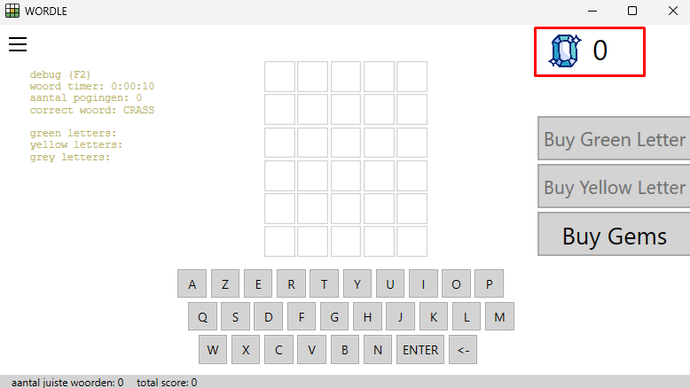

**Figuur 16**: Betalingssysteem - De speler kan zelf kiezen hoeveel euros hij of zij uitgeeft. Op basis van de geldigheid van de input, krijgt de speler een respons.

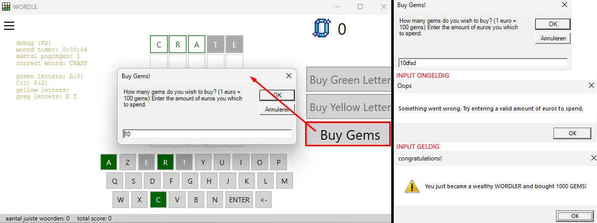

**Figuur 17**: Groene letters met positie.

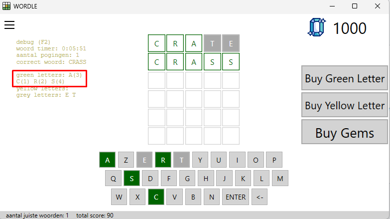

**Figuur 18**: Buy Green Letter - De speler kan een groene letter kopen door tien gems uit te geven.

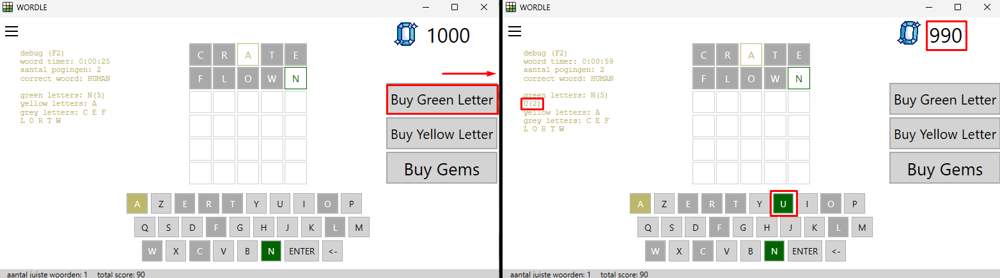

**Figuur 19**: Buy Green Letters Disabled - Wanneer alle groene letters al gevonden zijn, dan wordt de knop disabled.

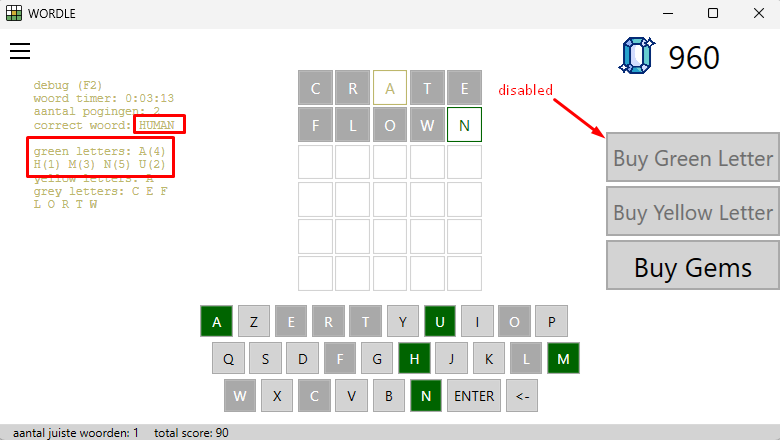

**Figuur 20**: Buy Yellow Letter - De speler kan een gele letter kopen door vijf gems uit te geven.

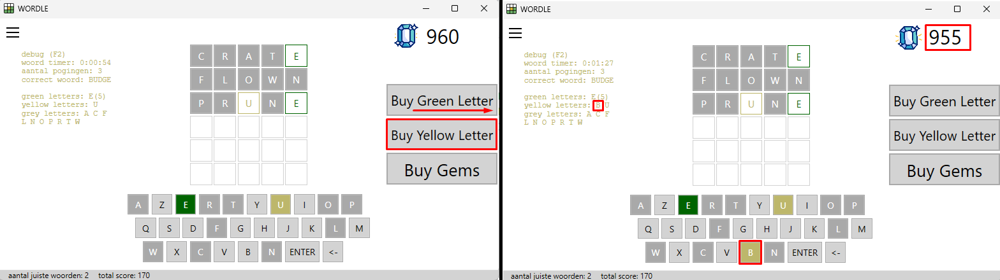

**Figuur 15**: Buy Yellow Letter Disabled - Wanneer alle letters in ofwel de groene of gele array staan, dan wordt de knop disabled.

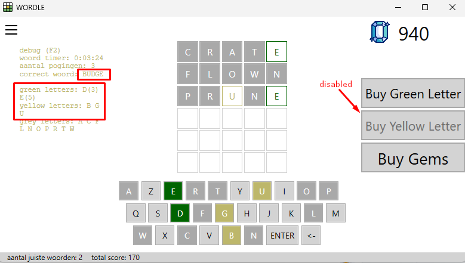


**Belangrijk**: Deze afbeeldingen zijn louter een voorbeeld. Het is de bedoeling om je eigen lay-out voor het spel te bepalen. 


## 6.2.2 Functionele vereisten

| ID           | Onderwerp                      | Beschrijving                                                                                                                         |
|--------------|--------------------------------|-------------------------------------------------------------------------------------------------------------------------------------|
| **WORDL-21** | **Gems**					    | Als speler kan ik een gem icoon op het venster zien naast mijn totaal saldo van gems dat ik gekocht heb in de applicatie. Elke speler start met 0 gems. *(Zie figuur 15)*  |
| **WORDL-22** | **Betalingssysteem: Gems**     | Als speler kan ik via een dialoogvenster ingeven hoeveel euro ik wil uitgeven aan gems. Zorg er voor dat de speler een geldige hoeveelheid (int) van euros ingeeft. Indien ik als speler ongeldige input geef, dan wordt de betaling afgebroken en wordt ik op de hoogte gebracht van mijn ongeldige input. *(Zie figuur 16)* </br></br>Bij een succesvolle transactie kan ik als speler in een bericht venster zien hoeveel gems ik heb gekocht. Elke euro dat de speler betaalt, levert hem/haar honderd gems op.|
| **WORDL-23** | **Groene letter met positie**  | Als speler kan in het debug-menu niet alleen de groene letters zien, maar ook hun positie in het woord. </br></br>*Bijvoorbeeld als de letter A de eerste letter is van het woord, dan wordt de letter als volgt getoond in het debug-menu: A(1).* </br></br> Als een letter meerdere keren verschijnt in een woord, dan toon je enkel de eerste positie van de letter in het woord. *Bijvoorbeeld de "O" in SPOON wordt getoond als: 0(3)* </br></br>*(Zie figuur 17)*|
| **WORDL-24** | **Betaal voor hints groen**    | Als speler kan ik op een "koop groene letter"-knop klikken om tien gems uit te geven en een willekeurige groene letter te onthullen. Deze letter verschijnt in het debug-menu onder de groene letters en wordt groen gemarkeerd in het toetsenbord, maar staat niet als een letter in de historiek van vorige pogingen. </br></br> Deze knop is enkel enabled als de speler beschikt over voldoende gems/budget en het woord nog niet geraden is. *(Zie figuur 18 en 19)* </br></br> Indien de willekeurige groene letter reeds geel was, dan wordt deze ook automatisch verwijderd uit de `yellowLetters` array.|
| **WORDL-25** | **Betaal voor hints geel**     | Als speler kan ik op een "koop gele letter"-knop klikken om vijf gems uit te geven en een willekeurige gele letter te onthullen. Deze letter verschijnt in het debug-menu onder de gele letters en wordt geel gemarkeerd in het toetsenbord, maar staat niet als een letter in de historiek van vorige pogingen.</br></br>Deze knop is enkel enabled als de speler beschikt over voldoende gems/budget en er nog onbekende letters zijn van het woord. *(Zie figuur 20 en 21)* |
| **WORDL-26** | **Score**                      | Voeg een scoremechanisme toe dat punten toekent voor elk juist geraden woord. Spelers ontvangen extra punten als zij het woord raden in minder pogingen. Voeg verder de totale score van alle woorden toe in de status balk van het venster. </br></br> Een speler verdient 100 punten als hij of zij een woord correct raadt, maar verliest 10 punten voor elke ronde die hij/zij nodig had om het correct te raden na de eerste. *(Bijvoorbeeld: een speler die het woord correct raadt in de tweede poging, ontvangt 90 punten.)* |
| **WORDL-27** | **Geen reset knop**            | De "Reset"-knop is een oude feature van sprint 1. Deze knop mag niet meer beschikbaar zijn, aangezien deze knop extra pogingen op hetzelfde woord zou toestaan. |
| **EXTRA-01** | **Hard-mode**                  | Implementeer een optionele hard-mode. In deze modus moet de speler alle eerder gevonden gele en groene letters gebruiken in elke nieuwe poging. De hard-mode is aan- en uit te schakelen via een knop in het menu wanneer de speler nog geen poging heeft gemaakt voor het huidige woord.</br></br>Een speler ontvangt dubbel zoveel punten als hij of zij een correct woord raadt in hard-mode.|
| **EXTRA-02** | **Meerdere woordlengtes**      | Voeg ondersteuning toe voor zes- en zevenletterwoorden. De speler kan kiezen tussen verschillende woordlengtes via het instellingenmenu. Zorg ervoor dat de implementatie geen dubbele code bevat. |


## 6.3 Aanpak en tips

### 6.3.1 Stappenplan
- Start eerst met het toevoegen van een betalingssysteem voor gems en het toevoegen van een totale score.
- Het uitvoeren van de checks voor het kopen van groene of gele letters, zal het moeilijkste zijn. Maak hiervoor extra methodes aan en aparte booleans om je controles in stukken op te breken en makkelijker te maken (om te programmeren en te debuggen).
- Voeg enkel EXTRA features toe, als je klaar bent met al de rest. De EXTRA features kunnen je een extra punt opleveren tijdens de PE.

### 6.3.2 Programmeertips
- Gebruik een StringBuilder om de inhoud van het debug-menu op te bouwen.
- Maak een methode die de gem knoppen disabled en enabled op basis van de letters  in het geheime woord, de letters in de green- en yellowletters array en het kapitaal van de speler. Hergebruik de methode doorheen je applicatie.
- Voorzie een Win() methode waarin je de score verhoogt op basis van het aantal pogingen.
- Gebruik Random om een willekeurige letter te selecteren. Controleer met behulp van lussen en checks of de letter al gevonden was.
